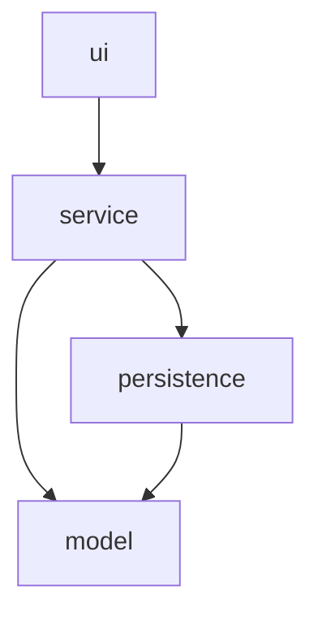

# Taller-GameZoneUnicesar-P3
A repository focused on Taller 2 based on the game store system GameZone Unicesar.
Facultad de Ingenierías y Tecnológicas, Universidad Popular del Cesar, SS462 Programación de Computadores III Grupo 02-CAMPUS

## About
GameZone Unicesar is a game store space located in Valledupar's Universidad Popular del Cesar University. This store is focused on selling gaming products to the Unicesar community, such as consoles, videogames, and other peripherals and gadgets like controllers, cables, memory.
The system is 100% built on Java with Maven, based on OOP (Object-Oriented Programming) and layered architecture theory, providing a consistent flow of data between the customers, store owners and employees. 

## Reference Implementation Notice
This repository was built and is maintained by two users; alvarodaramendiz and jahdieldtorres, as documented in [TEAM.md](TEAM.md), following a persistent dynamic of leadership and development through the entire project.

## Architecture
As mentioned before, the system is based on layered architecture theory, which is represented as a simple model of packages that function in a hierarchical dynamic.
A parent package **com.gamezone** is used to contain the entire package architecture. It contains the following: `model, persistence, service, ui` which, when related to the parent package, appear as `com.gamezone.model, com.gamezone.persistence, com.gamezone.service, com.gamezone.ui`

The layered architecture that GameZone contains is the following: `com.gamezone.ui -> com.gamezone.service -> com.gamezone.persistence -> com.gamezone.model`

## Requirements

- Java 17 or later
- Maven 3.8 or later
- GitHub CLI (`gh`) — only for reproducing the workflow used to build this repository

## Extended Modules

As the business grows, requirements are met to accomplish more customers. This considers an additive process of new modules into the system.

### Version 1.0.1 — Accessory Module

Adds controllers, cables and memories as sellable products (`Accessory` extends `Product`, with `Controller`, `Cable` and `Memory` as subclasses), stored in `data/accessories.csv` by `AccessoryRepository` and managed by `AccessoryService`. It relates to `Console` through the list of compatible consoles, to `SaleService`, which sells accessories together with video games and consoles and updates their stock, and to `ReturnService`, which restores their stock when they are returned. 

- `AccessoryPanel` lets the user register an accessory of each type, list every accessory, query accessories by type and find the accessories compatible with a console.

### Version 1.0.2 — Promotion Module

Adds time-limited promotions (`Promotion` with `PercentageDiscount`, `CategoryDiscount` and `BulkPurchaseDiscount`), stored in `data/promotions.csv` by `PromotionRepository` and managed by `PromotionService`. It relates to `Sale`, whose subtotal is used to calculate the discount, to `SaleService`, which applies the best active promotion to each sale, and to the accessory module, since a category discount can target video games, consoles or accessories. 

- `PromotionPanel` lets the user register a promotion of each type, list every promotion and list the promotions active today.

### Version 1.0.3 — Warranty Module

Adds a 6-month basic warranty for every sold console and an optional 12-month extended warranty that costs 10% of the price (`Warranty` with `BasicWarranty` and `ExtendedWarranty`), stored in `data/warranties.csv` by `WarrantyRepository` and managed by `WarrantyService`. It relates to `Product` and `Sale`, which every warranty references, to `SaleService`, which creates the warranties and adds the extended cost to the total, and to `ReturnService`, which cancels the warranties of a returned console. 

- `WarrantyPanel` lets the user search a sale and check the warranty of one of its products, list every warranty, list the active warranties and list the warranties about to expire.

### Version 1.0.4 — Return Module

Adds partial returns of a sale within 30 days (`Return`), stored in `data/returns.csv` by `ReturnPersistence` and managed by `ReturnService`. It relates to `Sale` and `SaleService` to find the original sale, to `ProductService` and `AccessoryService` to restore the stock, to the promotion module because the refund is proportional to the discount of the sale, and to `WarrantyService` to cancel and refund the warranties of returned consoles. 

- `ReturnPanel` lets the user search a sale and register a return, list the returns by customer or by sale, and see the monthly report with total sales, total returns and net balance.