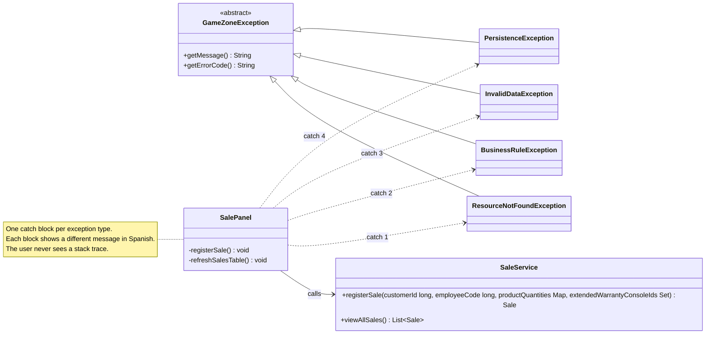

# Exception Handling and Validation Layer — Class Diagram

Classes of Requirement 6 and how they integrate with the existing system.

- `com.gamezone.exceptions` is a cross-cutting layer: every other layer can use it.
- `com.gamezone.validation` sits logically between `service` and `model`. The services call the validators; the validators never call services or repositories and never access files.
- The persistence classes catch `IOException` internally and rethrow it as `PersistenceException`, keeping the original cause.
- The UI panels replace the generic `catch (IllegalArgumentException)` with one `catch` block per custom exception type, each showing a different message in Spanish.

## 1. Exceptions, validators, services and persistence

```mermaid
classDiagram
    direction TB

    class RuntimeException {
        <<Java>>
    }

    class GameZoneException {
        <<abstract>>
        -errorCode: String
        +GameZoneException(message String)
        +GameZoneException(message String, errorCode String)
        +getErrorCode() String
    }

    class ResourceNotFoundException {
        +ResourceNotFoundException(resourceType String, id String)
    }

    class BusinessRuleException {
        +BusinessRuleException(message String)
    }

    class InvalidDataException {
        +InvalidDataException(fieldName String, description String)
    }

    class PersistenceException {
        +PersistenceException(message String, cause Throwable)
    }

    class ProductValidator {
        -ProductValidator()
        +validateProductData(id String, title String, price double, stock int)$ void
        +validateStockAvailability(product Product, requestedQuantity int)$ void
        +validateProductExists(product Product, productId String)$ void
    }

    class PersonValidator {
        -PersonValidator()
        +validatePersonData(id String, name String, email String, phone String)$ void
        +validatePersonExists(person Person, personId String)$ void
        +validateUniquePerson(existing List, newId String)$ void
    }

    class SaleValidator {
        -SaleValidator()
        +validateSaleData(customer Customer, seller Seller, products List~Product~)$ void
        +validateSaleExists(sale Sale, saleId String)$ void
    }

    class ProductService {
        +registerVideoGame(videoGame VideoGame) String
        +registerConsole(console Console) String
        +updateStock(productId String, quantity int) void
    }

    class CustomerService {
        +registerCustomer(eMail String, name String, iD long, contactNumber long) void
        +updateCustomer(iD long, eMail String, name String, contactNumber long) void
        +deleteCustomer(iD long) void
    }

    class SellerService {
        +registerSeller(employeeCode long, shift Shift, name String, iD long, contactNumber long) void
        +updateSeller(employeeCode long, shift Shift, name String, iD long, contactNumber long) void
        +deleteSeller(employeeCode long) void
    }

    class SaleService {
        +registerSale(customerId long, employeeCode long, productQuantities Map, extendedWarrantyConsoleIds Set) Sale
        +viewAllSales() List~Sale~
    }

    class ProductPersistence {
        +saveProduct(product Product) void
        +listProducts() List~Product~
        +updateProduct(product Product) void
    }

    class CustomerPersistence {
        +saveCustomer(customer Customer) void
        +listCustomers() ArrayList~Customer~
        +updateCustomer(customer Customer) void
        +deleteCustomer(iD long) void
    }

    class SellerPersistence {
        +saveSeller(seller Seller) void
        +listSellers() ArrayList~Seller~
        +updateSeller(seller Seller) void
        +deleteSeller(employeeCode long) void
    }

    class SalePersistence {
        +saveAll(sales List~Sale~) void
        +loadAll() List~Sale~
    }

    RuntimeException <|-- GameZoneException
    GameZoneException <|-- ResourceNotFoundException
    GameZoneException <|-- BusinessRuleException
    GameZoneException <|-- InvalidDataException
    GameZoneException <|-- PersistenceException

    ProductValidator ..> InvalidDataException : throws
    ProductValidator ..> BusinessRuleException : throws
    ProductValidator ..> ResourceNotFoundException : throws
    PersonValidator ..> InvalidDataException : throws
    PersonValidator ..> BusinessRuleException : throws
    PersonValidator ..> ResourceNotFoundException : throws
    SaleValidator ..> InvalidDataException : throws
    SaleValidator ..> BusinessRuleException : throws
    SaleValidator ..> ResourceNotFoundException : throws

    ProductService ..> ProductValidator : validates with
    CustomerService ..> PersonValidator : validates with
    SellerService ..> PersonValidator : validates with
    SaleService ..> SaleValidator : validates with
    SaleService ..> ProductValidator : validates with
    SaleService ..> PersonValidator : validates with

    ProductService ..> BusinessRuleException : throws
    CustomerService ..> InvalidDataException : throws
    SellerService ..> InvalidDataException : throws
    SellerService ..> BusinessRuleException : throws
    SaleService ..> InvalidDataException : throws
    SaleService ..> BusinessRuleException : throws

    ProductService --> ProductPersistence
    CustomerService --> CustomerPersistence
    SellerService --> SellerPersistence
    SaleService --> SalePersistence

    ProductPersistence ..> PersistenceException : wraps IOException
    CustomerPersistence ..> PersistenceException : wraps IOException
    SellerPersistence ..> PersistenceException : wraps IOException
    SalePersistence ..> PersistenceException : wraps IOException
```

## 2. User interface and differentiated handling

Each panel calls its services inside a `try` block and catches the four custom exceptions by their specific type. The four types are siblings (none is a subclass of another), so the order of the `catch` blocks does not change which one runs. `SalePanel` is shown as an example because it can receive all four types; `ProductPanel`, `PersonPanel`, `AccessoryPanel`, `PromotionPanel`, `WarrantyPanel` and `ReturnPanel` follow the same pattern.

### Messages shown to the user

| Exception | Message (Spanish) |
|---|---|
| `ResourceNotFoundException` | No se encontró el recurso solicitado: *detalle* |
| `BusinessRuleException` | No se puede completar la operación: *detalle* |
| `InvalidDataException` | Los datos ingresados no son válidos: *detalle* |
| `PersistenceException` | Ocurrió un problema al acceder a los datos del sistema. Contacte al administrador. |
