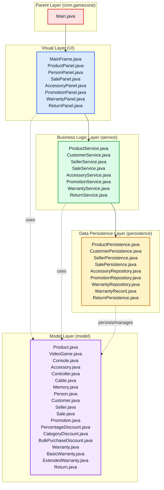

# Layer Diagram — GameZone Unicesar

This is the resulting four-layer architecture after the integration of Requiremnt 5 adjustments: products, people, sales, accessories, promotions, warranties and returns now stay in the same diagram, within the same layer functionality.

## Layer responsibilities

| Layer | Package | Responsibility |
|---|---|---|
| Presentation | `com.gamezone.ui` | Swing windows and panels; reads user input and shows results and messages in Spanish. |
| Business logic | `com.gamezone.service` | Business rules: stock validation, best promotion, warranty assignment, return rules and monthly balance. |
| Data access | `com.gamezone.persistence` | Reads and writes the text/CSV files in `data/`. |
| Model | `com.gamezone.model` | Domain classes and hierarchies (products, accessories, people, sales, promotions, warranties, returns). |

Dependencies always go in one direction: `ui → service → persistence → model`.

