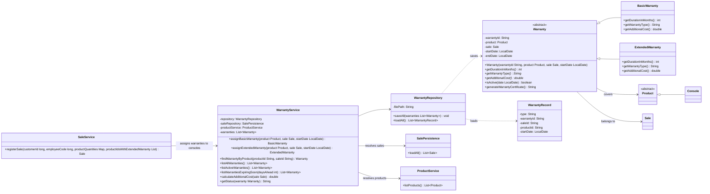

# Warranty Module — Class Diagram

Classes of the warranty module and how they integrate with the existing system.
After adjustment A2, `WarrantyRepository` stores and loads only the identifiers of
the sale and the product, and `WarrantyService` resolves them using `SalePersistence`
and `ProductService`. This removes the cycle SaleService → WarrantyService →
WarrantyRepository → SaleService.

## Construction order (MainFrame)

1. `ProductService`, `SellerService`, `CustomerService`, `AccessoryService`, `PromotionService`
2. `SalePersistence`
3. `WarrantyRepository` (no dependencies)
4. `WarrantyService(warrantyRepository, salePersistence, productService)`
5. `SaleService(..., warrantyService)`
